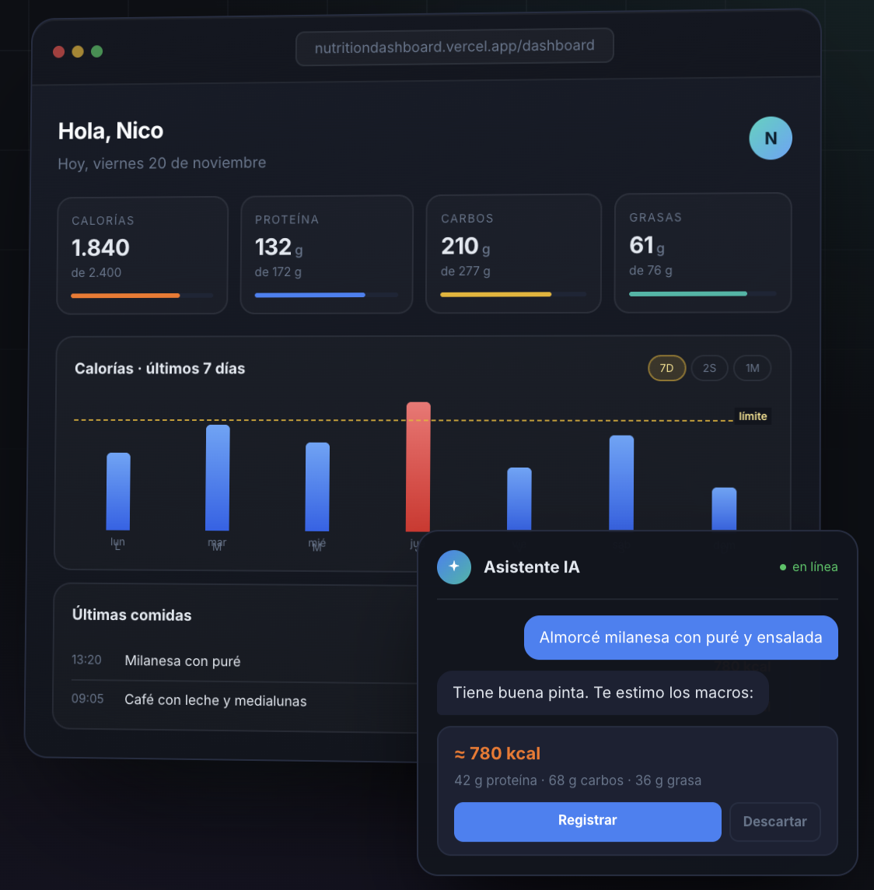

# 🏋️ Nutrition Dashboard

A personal nutrition dashboard for the browser, with an AI chat that estimates the macros of
what you ate — by text or by photo — and an **API + MCP layer** so an agent can read your day and
log meals for you.

**[Live app](https://nutritiondashboard.vercel.app)** · **[API docs](https://nutritiondashboard.vercel.app/developers)** · Try it with the **demo** button on the landing, no account needed.



---

## What it does today

### Track the day
- **Four macro cards** — calories, protein, carbs and fat against your own daily targets, with
  progress bars that turn red when you go over.
- **Calorie chart** with 7D / 2W / 1M / 3M windows: one bar per day, your limit line and your
  TDEE line. Days over the limit are highlighted.
- **Last meals** — the latest entries with time, name and kcal. Deleting one asks for
  confirmation first; there is no undo.
- **Today's workout** — shows what burned today and the net balance (eaten minus burned).
  Workouts are logged through the API or MCP; the web form is still pending.
- **Meal plan** — a static weekly reference (weekdays and weekend) with tips. It is a guide, not
  something generated per user yet.

### Chat with AI
- A side panel that stays open while you browse the dashboard (side or overlay, your choice;
  the width is draggable).
- Tell it what you ate in plain Spanish and it returns an estimate with calories, protein, carbs
  and fat. **Register** saves it to the day; **Discard** throws it away.
- **Photos**: take one with the camera (touch devices) or pick from the gallery. The image is
  compressed in the browser to a JPEG of at most 1024 px before uploading; a vision model
  describes the dish and estimates.
- It knows your diets (vegetarian, vegan, pescatarian, lactose-free, gluten-free, nut-free) and
  your country, which helps with portions.
- Estimates are a **guideline, not a scale**: the margin is around ±30%, and the UI says so.

### Weight progress
- Line chart with 2W / 1M / 3M / 6M / 1Y windows, your goal weight as a dashed line, and the
  change over the period.
- One measurement per day: logging twice overwrites.

### Goals, onboarding and account
- **3-step onboarding** on first login: sex, age, height, current weight, goal weight, activity
  level, special diets and country.
- It computes **TDEE** (Mifflin-St Jeor × activity factor), then a 20% deficit (capped at 500
  kcal) or a 10% surplus (capped at 300), and splits macros as **1.8 g/kg protein**, **0.8 g/kg
  fat** and the rest carbs.
- **My data** shows every stat and lets you re-run the wizard or delete the account.
- Login with email/password or **Google**. There is also a public **demo account** with seeded
  history.

### API and MCP for agents
- **MCP server** (Streamable HTTP, stateless) with 8 tools, for Claude Code, OpenClaw, Hermes and
  any MCP client.
- **REST API** under `/api/v1/*` for scripts and `curl`.
- **Per-user API keys** with scopes (`health:read`, `meals:write`, `weights:write`,
  `workouts:write`), an expiry of 90 days / 6 months / 1 year, and a free tier of 1 active key
  and 1,000 requests per day.
- The API does **not** estimate macros: the agent sends them and the server validates and stores.
- Full details: **[docs/API.md](docs/API.md)**.

---

## Tech stack

| Layer | Choice |
|---|---|
| Framework | **Next.js 16** (App Router) + React 19 |
| Database & auth | **Supabase** — Postgres, Auth (email + Google) and Row Level Security |
| Hosting | **Vercel** |
| AI chat | Provider abstraction over **Google Gemini** (text + vision) and **OpenRouter** (text) |
| Agents | **MCP** via `@modelcontextprotocol/sdk` + a REST API |
| Styling | Plain CSS, dark theme, no UI framework |

---

## How it works

- The web app talks to Supabase **directly from the browser** with the anon key. Every table has
  RLS policies for "own rows", so the database — not just the UI — decides who sees what.
- Server routes (chat, API v1, MCP, key management) run as Next.js route handlers on the Node
  runtime. Anything that needs the `service_role` key lives there and never reaches the client.
- The API and the MCP share the same data layer. Because `service_role` bypasses RLS, that layer
  filters by `user_id` **by hand on every query**.
- Day boundaries follow `profiles.timezone`, not the server's clock: a dinner at 21:00 in Buenos
  Aires belongs to that day, not the next one in UTC.
- The demo account is refreshed by a **GitHub Action** every two days: it shifts the dates of the
  existing rows so the last entry lands on yesterday. Today is intentionally empty — the point is
  that a visitor logs a meal themselves and sees the dashboard react.

---

## Data model

| Table | What it holds |
|---|---|
| `profiles` | One row per user (created by a trigger on signup): stats, activity, diets, country, timezone, tier and the computed targets |
| `meals` | Name, calories, protein, carbs, fat, `eaten_at` and an optional `client_ref` for idempotency |
| `weights` | `weight_kg` + `measured_at` (date only), unique per user per day |
| `workouts` | Type, duration, calories burned, notes, `started_at` |
| `api_keys` | Key metadata: name, prefix, scopes, expiry, revocation |
| `api_key_secrets` | Only the SHA-256 hash of each key, in a table with RLS on and no policies |
| `api_usage` | Daily request counter per key, used for the rate limit |

Migrations live in `supabase/migrations/` and are applied in order.

---

## Getting started

Requirements: Node 20.9+ (Next.js 16) and a Supabase project.

```bash
# 1. Install
npm install

# 2. Configure
cp .env.example .env       # then fill in the values
# 3. Apply the migrations in supabase/migrations/ (Supabase SQL editor or psql), in order.

# 4. Run
npm run dev                # http://localhost:3100
```

### Environment variables

| Variable | Needed for |
|---|---|
| `NEXT_PUBLIC_SUPABASE_URL` | Everything (client + server) |
| `NEXT_PUBLIC_SUPABASE_ANON_KEY` | Everything (client + server) |
| `SUPABASE_SERVICE_ROLE_KEY` | **Server only**: chat, API v1, MCP, key management, account deletion |
| `AI_PROVIDER` | `gemini` or `openrouter` — which chat provider is used |
| `GEMINI_API_KEY`, `GEMINI_MODEL` | Chat with Gemini (the one with vision) |
| `OPENROUTER_API_KEY`, `OPENROUTER_MODEL` | Chat with OpenRouter (current model is text-only) |
| `NEXT_PUBLIC_DEMO_EMAIL`, `NEXT_PUBLIC_DEMO_PASSWORD` | The public demo button; hidden when missing |

> Never commit `.env`. The `service_role` key must only exist as a server environment variable.

---

## Project structure

```
app/
├── page.js                 # public landing
├── developers/             # public API/MCP docs
├── api-keys/               # create, revoke and delete your API keys
├── dashboard/              # the app itself (macros, charts, chat, meal plan)
├── logout/
└── api/
    ├── chat/               # AI chat endpoint (estimates macros)
    ├── keys/               # key management (web session only)
    ├── v1/                 # REST API for agents
    ├── mcp/                # MCP server (stateless)
    └── admin/              # account deletion
components/                 # Landing, AuthModal, ChatWidget, Onboarding, ProfileModal…
lib/
├── health.js               # browser-side data access (RLS)
├── health-core.js           # pure helpers shared with the server
├── profile.js              # TDEE + macro math
├── ai.js                   # chat providers (Gemini / OpenRouter)
├── chatPhoto.js            # client-side image compression
└── api/                    # server-side layer: auth, data, validation, keys, tiers
supabase/migrations/        # schema + RLS + demo seed
scripts/                    # data migration, demo seed and demo date shifting
docs/API.md                 # API + MCP guide
```

---

## API and MCP

The dashboard exposes the same data the web shows — meals, weights, workouts and daily targets —
so an agent can read it and log new entries without opening the browser.

- **MCP server** (Streamable HTTP, stateless) with 8 tools: `get_profile`, `get_day_summary`,
  `list_meals`, `list_weights`, `list_workouts`, `add_meal`, `log_weight`, `log_workout`.
- **REST API** under `/api/v1/*`: profile, day summary, meals, weights and workouts.
- **Per-user API keys** with granular scopes. The token is shown once; only its SHA-256 hash is
  stored.
- Keys can read and log, **never delete**: removing meals, keys or the account happens in the
  web, with confirmation.
- The API does **not** estimate macros — the agent estimates and the server validates and stores.
  Accuracy depends on the client's model.

Documentation:

- 📖 Public docs — **https://nutritiondashboard.vercel.app/developers**
- 📄 In this repo — **[docs/API.md](docs/API.md)**

Create a key at **https://nutritiondashboard.vercel.app/api-keys**. The demo account cannot
create keys: it is public, so a key there would be open write access to anyone.

---

## Deploy

Vercel builds from `main`. Set the environment variables above in **Project → Settings →
Environment Variables** (the `NEXT_PUBLIC_*` ones are baked in at build time, so a redeploy is
needed after changing them) and push. No extra configuration is required: there are no
serverless functions beyond the Next.js routes and no background jobs in the app itself.

---

## What is not here yet

Honest list, so the README does not promise more than the app does:

- **Sports tab** — workout charts by type and a weekly exercise plan. Workouts are already stored
  and can be logged through the API/MCP, but the web has no form for them. It may end up as its
  own project.
- **Progress photos** — the legacy version had them.
- **Chat history** — the conversation lives in React state and is lost on refresh.
- **Chat rate limit** — 20 messages/day per user, counted in memory; it does not survive across
  serverless instances.
- **Signup email** — Supabase's built-in mailer hits its rate limit quickly; a custom SMTP is
  pending.
- **Meal plan** — static and omnivore, not adapted to each user's diets.

---

## License

MIT — fork it, learn from it, use it.
